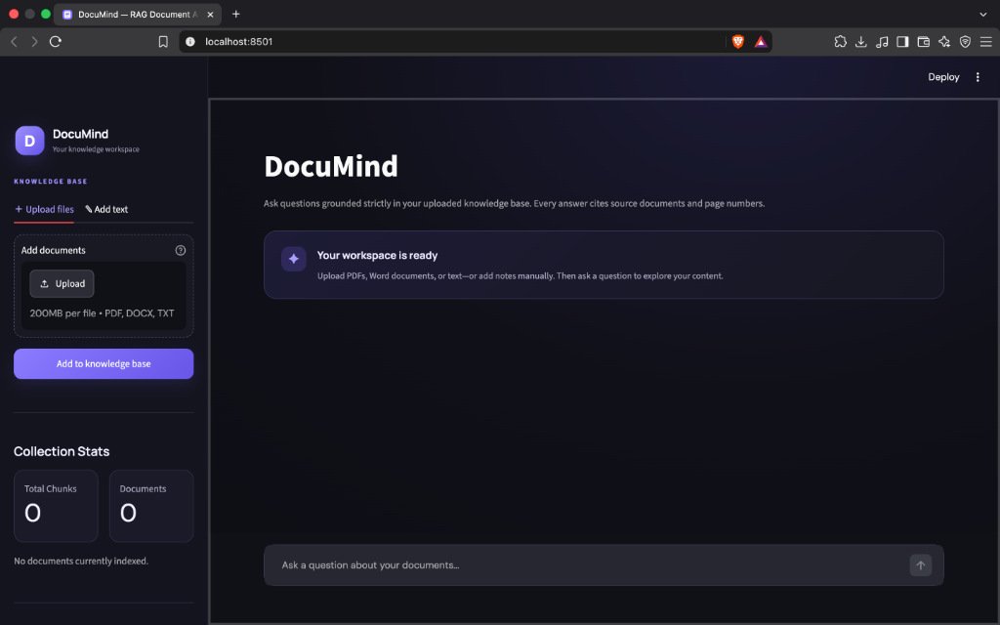
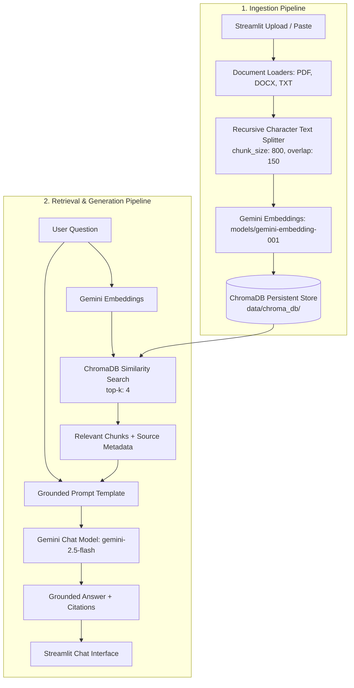

# DocuMind — Grounded RAG Document Assistant

A portfolio-quality, modular **Retrieval-Augmented Generation (RAG)** application built with Python, LangChain, Streamlit, ChromaDB, and Google Gemini API.

[](https://ragdocumind.streamlit.app/)
🔗 **Live Application:** [https://ragdocumind.streamlit.app/](https://ragdocumind.streamlit.app/)

DocuMind lets you upload documents (PDF, DOCX, TXT) or paste raw text notes, and ask questions through an intuitive chat interface. Answers are strictly grounded in your provided documents, with complete source citations (filename and page numbers) and built-in defense against hallucination.



---

## Key Features

- **Multi-Format Ingestion**:
  - **PDF Documents**: Page-by-page text extraction with page number preservation using `pypdf`.
  - **Word Documents (`.docx`)**: Extracts both paragraphs and structured tables using `python-docx`.
  - **Plain Text (`.txt`)**: Robust UTF-8 decoding with Latin-1 fallback.
  - **Manual Text**: Directly paste or type raw notes with optional custom source titles.
- **Strict Grounding & Hallucination Defense**:
  - Prompt engineered to prevent speculation or extrapolation.
  - Explicitly states when the answer is not present in the indexed documents rather than inventing facts.
- **Accurate Citations & Metadata**:
  - Every answer provides expandable citation badges with source filenames, page numbers, and chunk references.
- **Persistent Local ChromaDB**:
  - Vectors and chunk metadata are saved locally on disk (`data/chroma_db/`), persisting across application restarts.
- **Interactive Streamlit Workspace**:
  - Real-time ingestion progress indicators.
  - Live collection statistics (total chunks, source count, active indexed files).
  - One-click safe collection reset and chat history clearing.
- **Modern Tooling with `uv`**:
  - Blazing-fast virtual environment and dependency management powered by Astrals `uv`.

---

## High-Level Architecture



---

## Technology Stack

| Layer | Technology | Responsibility |
|---|---|---|
| **Environment & Package Manager** | `uv` | High-speed virtual environment and package installation |
| **Language** | Python 3.12 | Core application logic and type annotations |
| **User Interface** | Streamlit | Responsive file uploader, chat interface, and metrics |
| **Orchestration** | LangChain / LCEL | Splitters, prompt templates, output parsers, and chains |
| **LLM Generation** | Google Gemini API (`gemini-2.5-flash`) | Fast, grounded answer synthesis |
| **Embeddings** | Google Gemini Embeddings (`models/gemini-embedding-001`) | High-dimensional semantic vectors (3072 dims) |
| **Vector Database** | ChromaDB | Local persistent vector storage and similarity search |
| **Document Parsing** | `pypdf`, `python-docx` | Extraction from PDF pages, DOCX paragraphs, and tables |
| **Testing** | `pytest`, `streamlit.testing` | Automated unit and integration testing suite (36 tests) |

---

## Project Structure

```text
DocuMind/
├── app.py                      # Main Streamlit web application
├── config.py                   # Centralized configuration & environment loader
├── requirements.txt            # Project dependencies
├── .gitignore                  # Git exclusions (.env, .venv, chroma data)
├── pytest.ini                  # Pytest configuration
├── assets/
│   ├── documind_favicon.png    # Workspace favicon
│   └── documind_ui.png         # UI interface screenshot
├── data/
│   └── chroma_db/              # Persistent ChromaDB vector storage (.gitkeep)
├── src/
│   ├── __init__.py             # Source package root
│   ├── document_loader.py      # PDF, DOCX, TXT & manual text loaders
│   ├── text_splitter.py        # Recursive text chunking with metadata
│   ├── embeddings.py           # Gemini embedding model factory
│   ├── vector_store.py         # Persistent Chroma operations & reset
│   ├── retriever.py            # Similarity retrieval & citation formatting
│   ├── rag_chain.py            # Grounded LCEL chain & response packaging
│   └── utils.py                # Text normalization & document ID generation
├── scripts/
│   ├── verify_gemini.py        # Validates Gemini Chat & Embeddings API
│   ├── verify_chromadb.py      # Validates ChromaDB writes & persistence
│   ├── verify_retrieval.py     # Validates semantic search precision
│   ├── verify_rag_chain.py     # Validates grounding & hallucination defense
│   └── verify_e2e.py           # Full multi-format end-to-end pipeline test
└── tests/
    ├── test_app.py             # Headless Streamlit UI tests
    ├── test_document_loader.py # Unit tests for all loaders
    ├── test_text_splitter.py   # Unit tests for chunking & metadata
    ├── test_vector_store.py    # Unit tests for ChromaDB storage & reset
    ├── test_retriever.py       # Unit tests for retrieval & citations
    └── test_rag_chain.py       # Unit tests for RAG chain & prompt
```

---

## Quickstart Guide

### 1. Prerequisites
- **Python 3.12** installed.
- **Astral `uv`** installed (`curl -LsSf https://astral.sh/uv/install.sh | sh` or via Homebrew).
- A **Google Gemini API Key** (obtainable from [Google AI Studio](https://aistudio.google.com/)).

### 2. Clone the Repository
```bash
git clone https://github.com/shikhar0312/DocuMind.git
cd DocuMind
```

### 3. Create Virtual Environment & Install Dependencies with `uv`
```bash
# Create virtual environment
uv venv --python 3.12 .venv

# Activate environment
source .venv/bin/activate

# Install all dependencies
uv pip install -r requirements.txt
```

### 4. Configure Environment Variables
Create a `.env` file in the root directory:
```bash
# Set your Google Gemini API key
echo 'GOOGLE_API_KEY="your-api-key-here"' > .env
```

### 5. Launch the Application
```bash
streamlit run app.py
```
Open your browser at `http://localhost:8501`.

---

## Running Automated Tests

Run the full automated test suite (36 unit tests) using `pytest`:

```bash
pytest -v
```

### Running Standalone Verification Scripts

Test individual components against live Gemini endpoints:

```bash
# Test Gemini Chat & Embeddings connectivity
python scripts/verify_gemini.py

# Test ChromaDB local persistence & reload
python scripts/verify_chromadb.py

# Test semantic retrieval accuracy on known questions
python scripts/verify_retrieval.py

# Test RAG grounding and hallucination defense
python scripts/verify_rag_chain.py

# Test complete multi-format pipeline end-to-end
python scripts/verify_e2e.py
```

---

## Configuration Reference

You can customize the following settings in your `.env` file (or accept the defaults):

| Variable | Default Value | Description |
|---|---|---|
| `GOOGLE_API_KEY` | *(Required)* | Google Gemini API key |
| `GEMINI_CHAT_MODEL` | `gemini-2.5-flash` | Gemini model for answer generation |
| `GEMINI_EMBEDDING_MODEL` | `models/gemini-embedding-001` | Embedding model for semantic search |
| `GEMINI_TEMPERATURE` | `0.2` | Generation temperature (lower = more deterministic) |
| `CHROMA_PERSIST_DIR` | `data/chroma_db` | Disk directory for vector database persistence |
| `CHROMA_COLLECTION_NAME` | `rag_documents` | ChromaDB collection name |
| `CHUNK_SIZE` | `800` | Target character size for text chunks |
| `CHUNK_OVERLAP` | `150` | Character overlap between consecutive chunks |
| `RETRIEVAL_K` | `4` | Number of relevant chunks retrieved per query |

---

## License

MIT License. Free for educational and commercial use.
